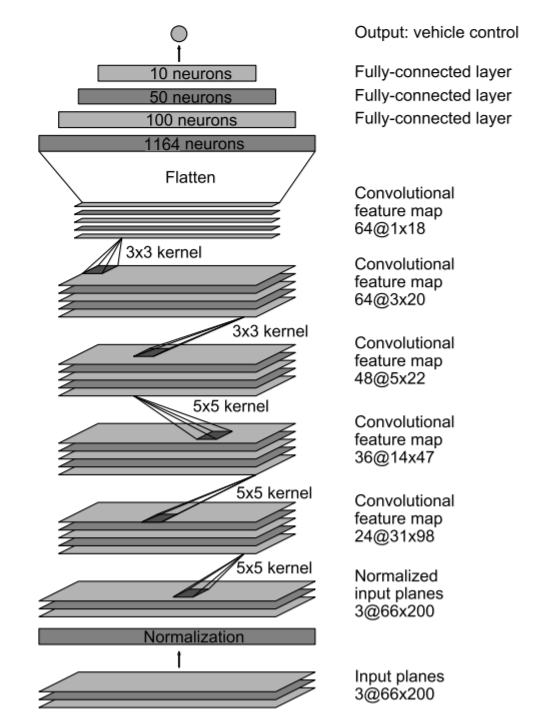
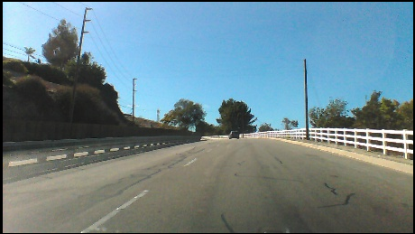

# Self Driving Car

Self-driving car with Keras DAVE-2 CNN

 

# Summary

CNNs are widely used to build self-driving car systems. NVIDIA’s DAVE-2 model is one of the simplest and most effective approaches for autonomous driving tasks. In this project, we implement DAVE-2 with Keras and use it to predict the steering angle of a vehicle.

# The Model

 

The DAVE-2 model takes road images as input and predicts vehicle control outputs, such as the steering angle. You can find the full paper **[HERE](https://arxiv.org/pdf/1604.07316.pdf)**.

# Dataset

 

The dataset consists of 45,406 images captured by a camcorder during a real car ride. It was created by Sully Chen. You can download it **[HERE](https://drive.google.com/file/d/0B-KJCaaF7elleG1RbzVPZWV4Tlk/view)**. If you want to train your own model instead of using the pretrained one, place the images inside a `data/` folder.

# How To Run

You can either use the pretrained model or train your own.

Note: Because the dataset is large, training may require high computational resources.

To train:
 `python3 train.py`

To run on the test set:
 `python3 run.py`

# Related Works - Source

-https://arxiv.org/pdf/1604.07316.pdf

-https://github.com/adityaguptai/Self-Driving-Car-

-https://github.com/tech-rules/DAVE2-Keras
